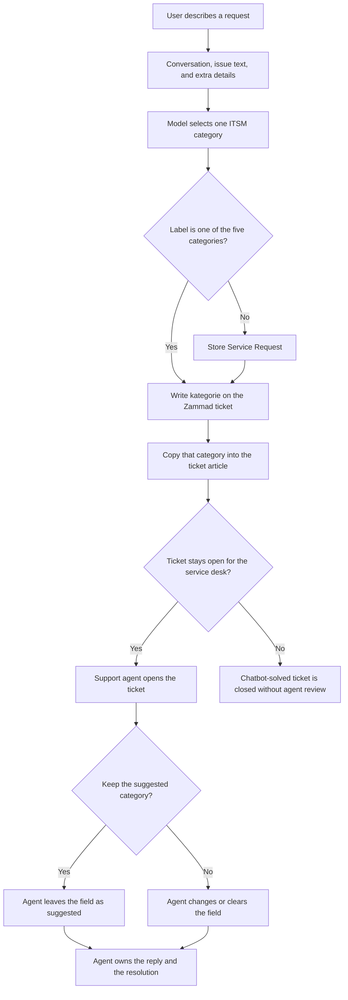

# Ticket triage

This page shows how a suggested ticket category reaches a support agent, and where that agent can still change it.

## Allowed categories

The model must return one of these labels. Overlap is resolved in this order: **Complaint**, then **Problem**, then **Change**, then **Service Request**, then **Incident**.

| Category | When it is selected |
| --- | --- |
| Complaint | The main intent is dissatisfaction with support, waiting time, communication, or missing help. A technical fault mentioned alongside that complaint does not override it. |
| Problem | The main intent is analysis of a recurring or underlying cause. A current outage stays an Incident even if several people are affected. |
| Change | The person wants a change to a system, configuration, permission, role, group, forwarding rule, or process. |
| Service Request | The person wants information, access, software, or another administrative action, and the request is not a current outage. In this project, payment, fee, invoice, refund, and accounting requests use this category even when a portal shows an error. |
| Incident | An IT service, device, network, or application is currently not working, and none of the categories above fits better. |

Anything outside this list is stored as **Service Request**.

## Path to the agent

The Zammad attribute is a single-select field named `kategorie`. Agents see it as **Kategorie**. It is visible to the customer and to the agent. On the agent edit screen it is shown, it is not required, and it can be emptied. Writing the value is therefore the suggestion. The support decision is the agent's later edit, together with the reply the agent sends.

The article body is a snapshot. It records the category that was current when the article was created. Changing the select field afterwards leaves that sentence in the article as history.

## What the support team decides

- Whether the suggested category stays, is replaced, or is cleared.
- How the open ticket is handled and what is sent back to the person who asked.
- The model does not approve its own category, and on this open-ticket path it does not close the request on behalf of the service desk.
